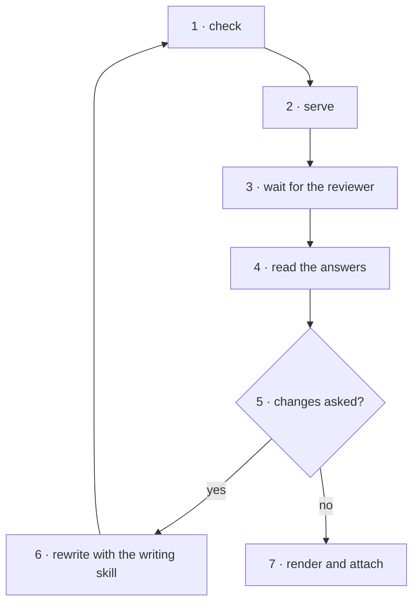

<!-- Generated by agent-pants from plugins/craft/skills/parley/parley.md; do not edit. -->

# `/parley`

Usage:

- `/parley check <doc.json>` validates a document: ids, anchors, references.
- `/parley serve [dir]` serves every document in `docs/parley/` (or `dir`) and watches it.
- `/parley render <doc.json> --out <page.html>` writes one static page for a PR or an artifact;
  `--out <doc.md>` (or `--format markdown`) writes the same document as markdown: headings,
  lists, tables and mermaid fences, for a PR body, a README or any markdown viewer. The markdown
  opens with an OKF frontmatter block, which a file under `docs/` needs; strip it before pasting
  into a PR body or comment, where it would show as stray text.
- `/parley answers <id>` reads `docs/parley/<id>.answers.json` and reports what the reviewer
  said; `--mark-read` marks what it printed as read, so later answers show as new;
  `--wait` blocks until the reviewer sends something new, prints it and exits;
  `--reply <id> --text "…" --model <your model id>` answers a comment, or an asked-back,
  noted or reopened question, in place; the page shows who answered on hover.

Scope: validate, render, serve and read back. Not in scope: writing the document
(`/explain` or `/propose-solution` does that) or acting on the answers.

Inputs: a document whose blocks all have a known type. Output: a page at `/d/<id>`, and
`docs/parley/<id>.answers.json` once the reviewer acts.

## The document

- `id`, `title`, `created`, `blocks`, optional `summary`, `questions`, `repo`, `revision`,
  `storybook` and `storybookStart`. `id` is the file stem. `repo` is `{remote, commit, root}`: the
  GitHub remote, the commit the sources were read at, and the absolute path of the checkout.
  `revision` starts at 1 and goes up on every rewrite of the questions. `storybook` is the base URL
  stories embed from; `storybookStart` is the command that starts it, shown when it is down.
- `blocks` is an ordered list; the page stacks them. Each has `id`, `type` and an optional
  `title`. Types (their fields are in `src/blocks/types.ts` of the `@sksizer/parley` package):
  - `prose`: a few paragraphs. One node.
  - `question`: one or more questions placed in the centre column at that point in the
    reading. One node, with a compact walkthrough row for comments on its words; each
    question is one as well.
  - `figure`: one image with a caption and an optional link to its live version; `src` is a
    path under `x/` beside the document (the servlet serves it). One node; the walkthrough
    carries the detail.
  - `story`: live Storybook stories and screenshots side by side, with a `caption` and a
    `detail` for the walkthrough. One node.
  - `annotated-text`: any text with numbered steps anchored into it. One node per step; steps
    may nest. `language: sql` tints keywords. An anchor is a W3C Web Annotation selector:
    `{"type": "TextQuoteSelector", "exact": "…"}` with `prefix` and `suffix` when the quote
    repeats, or `{"type": "TextPositionSelector", "start", "end"}` for offsets.
  - `schema`: tables with columns, keys, indexes and relations, grouped by domain. One node per
    table, and one per column for comments.
  - `operations`: ordered operations with risk, locks, rollback and before/after, grouped into
    phases. One node per operation.
  - `matrix`: rows by columns, each cell valid, warn, error or skip with a note and a hint. One
    node per row; columns are selectable for questions.
  - `trace`: one request walked through ordered candidates, each with an outcome and a reason.
    One node per step.
  - `precedence`: an ordered ladder where the first match wins, with examples showing the rung
    each stops at. One node per rung and per example.
  - `plan`: phases, workstreams and tasks with gate, milestone and status. One node each.
  - `code-flow`: one path through code across functions and files, drawn as a sequence
    diagram: participants are the `symbol`s (or files) the steps run in, messages are the
    steps in order, a `return` is a dashed arrow back, an `emit` an open-headed one, a
    `branch` an alt frame. The mermaid source sits under the diagram. One node per step; the
    walkthrough carries the step's lines, detail and warnings. Use `annotated-text` for one
    text; `code-flow` when the path crosses files.
  - `workflow`: a standard process drawn as a top-down flowchart: a rounded node per step
    with its lane written in it, a diamond for a decision, a stadium for start and end, edges
    labelled with their condition, loops routed on the left. The mermaid source (with lanes
    as subgraphs) sits under the diagram. One node per step and per lane.
  - `diff`: a unified diff (`git diff`, `gh pr diff`) with review findings anchored to its lines.
    The left pane shows every file and hunk, a numbered badge on each finding's first row and every
    row it covers highlighted; each finding is a section with its severity, `file:line`, the rows
    around it, detail and an optional `suggestion`. `line`/`endLine`/`side` (`new` default, or
    `old`) count the way GitHub review comments do (RIGHT = new, LEFT = old), and every line must
    sit in one hunk: a deleted file's lines are `side: old`. A finding on a binary file is an error,
    and so is a hunk whose body does not match its header's counts. A new-side finding links to its
    lines in the checkout; an old-side one has no `source` unless given. Severities colour by name
    (violation, blocker: bad; tension, major: warn; drift, nit: skip; praise: ok); `severities`
    overrides. One node per finding.
- Every node has a stable `id`, unique across the document. Answers key on document id and
  node id, so a regenerated page keeps its answers. Never renumber ids on a rewrite.
- Any node or block may carry `source`, an LSP Location: `{"uri": "<path from the repo root>",
  "range": {"start": {"line", "character"}, "end": {…}}}`, zero-based. The page shows it as a
  local editor link (scheme chosen once per browser) and a GitHub permalink pinned to
  `repo.commit`.
- A question has `kind` single, multi or text, `options`, the agent's `recommended` option, and
  `about`, the node it hangs on. Put a question where the reader meets the thing it decides: a
  question with `about` appears in the walkthrough directly under that node; a `question` block
  appears in the centre column at its place in the reading; a question with neither sits in the
  closing section. The nav, the meter and the sidecar treat all three the same. `group` is an
  optional heading the nav lists the question under.
- Media: a question, each of its options, and a `story` block may carry `stories` and `shots`. A
  story is an id from `<storybook>/index.json` (title and export in kebab case, such as
  `explore-file-view--tabs-today`) or `{id, label, globals, height, width, storybook}`: `globals`
  such as `theme:dark`, `width` the width it lays out at (default 1440; the page scales it to fit),
  `height` (default 480), `storybook` another base. A shot is a path from the repository root, or
  `x/<file>` beside the document, or `{path, caption}`; `.webm` and `.mp4` play as video. Options
  with media sit side by side as cards. Use shots for states a story cannot reach.
- A settled question gets `status: closed` and a one-line `resolution`. The page collapses it and
  shows the reviewer's choice, or the only option, as decided.
- The reviewer can **Reopen** a closed question or one they answered. That clears the choice back to
  open, keeps the old answer in `history`, and stamps `reopened` on the choice (`at`, the `revision`
  it was made on, `closed` and `resolution` for a closed one, `cleared` naming the answer it
  cleared). It arrives at once as `[reopen] <question id>` and stays pending until you reply into
  the question. The reopen holds, and overrides `status: closed`, until you settle it, and only a
  reply after the reopen can settle it: a rewrite with no reply leaves it open. `--reply` stamps the
  document's `revision` on your reply, and the next `revision` after it settles the reopen, whatever
  the question then says (a revision between the reopen and your reply does not), so a question
  closed again, even with the same `resolution`, is closed. A question that was not closed is also
  settled once you have replied and the reviewer has answered again. The servlet then drops
  `reopened`.
- The sidecar holds `status` (`reviewing`, then `changes-requested` or `approved`, with `finished`
  and an optional `summary`), `comments[]` (`node`, `text`, `at`) and `choices` keyed by question
  (`selected`, `note`, or `ask` instead of a choice; `sent` and `replies` once the ask or note went
  to the agent; `reopened` once the reviewer reopened it). A comment made on selected words also
  carries `selector`, a `TextQuoteSelector` with the exact words inside that node; read it as the
  reviewer pointing at those words. The servlet stamps each changed choice with the question's
  `hash` and the document's `revision`, and keeps the answer it replaced in `history` (saves within
  15 minutes in one revision replace each other). `notes` is the reviewer's text on the whole
  document, with its own `history`; `seen` maps each question to the hash the reviewer last looked
  at; `agentReadAt` is set by `--mark-read` and `reopenedAt` by `--reopen`. Never edit the sidecar
  by hand.
- Every question offers "None of these, or I have a question". That stores `ask` instead of a
  choice, the question stays open, and the reviewer chooses after the agent replies. Words typed
  with no option ticked tick it, so they arrive as an ask; a note beside a ticked option stays a
  note. A choice question is answered only by a pick: a note with nothing picked shows as
  `open, note with no pick` in the digest.
- A comment goes to the agent as it is added (it carries `sent`); **Save draft** keeps it private
  until the reviewer sends it, alone or with **Send N to agent** in the top bar. An asked-back
  question, or a note written beside a chosen option, is sent with its own button and arrives as
  `[ask]` or `[note]`; a bare pick reaches the agent with the verdict, and **Finish review** sends
  any unsent note first. Editing a sent ask or note, or changing the options under a sent note,
  makes it a new message to send; once the agent has replied it goes as a follow-up in the thread.
  Under each sent comment, ask or note is a thread, `replies[]`: the agent's messages (`from` agent,
  `text`, `action` answered, changed or declined, `by`) land there with `--reply` and the open page
  shows them at once; the reviewer's follow-ups (`from` reviewer, `sent`) go to the agent as they
  are added and re-arm `--wait` under the same id. A thread is awaiting the agent while its last
  reviewer message has no agent message after it.
- A new block type is one file under the package's `src/blocks/` exporting `render`, `check` and
  `markdown`, registered in `src/blocks/index.ts`, then rebundled into `parley.mjs`. The shell,
  servlet and sidecar do not change.
- When a subject does not fit the block types above, do not force it into `prose`. Write the
  document with the nearest block, and say in its first prose block what block type would
  have fit, with the fields it needs, so the owner can add it. Do the same for a domain note
  neither `/explain` nor `/propose-solution` has yet.

## The page

- Left: the thing itself, numbered. Right: one scrolling walkthrough, one section per node,
  with its comment box; the agent's questions at the bottom. The walkthrough carries only what
  the left does not show: a step's explanation, a table's columns, an operation's lock and
  rollback. A node the left shows in full (a paragraph, a rung, a task) gets a compact row
  that exists for comments. Put linear reading on the left; keep the right for depth.
- Click or hover any pane and the others highlight. `j`/`k` step sections, `n`/`p` step
  questions (with shift, open ones only; the arrows beside the meter do the same), `Esc`
  clears, the URL hash deep-links a node.
- Select any words in the centre or the walkthrough and a **Comment** pill appears above them;
  the comment lands on the node under the selection, quoting the words, which stay highlighted
  on every later render until they change. Hovering quoted words shows their thread; a click
  goes to it in the walkthrough. **General notes** at the end of the walkthrough take anything
  that is not about one node.
- Media: a story frame loads one at a time (a Storybook dev server serves each story as hundreds
  of modules), and Expand opens it full size. When a document's Storybook does not answer, a
  banner says so and shows `storybookStart`. `serve --storybook <url>` replaces the document's
  base, for a Storybook on another port.
- A question edited since the reviewer last looked at it shows "Changed since you last looked";
  an answer given before the edit shows as one that predates it. Earlier answers sit under the
  question. A closed question counts as answered.
- When the document asks questions, a progress meter under the title shows one segment per
  question: red open, amber asked back, green answered, with a tally. A segment jumps to its
  question in the walkthrough.
- The header shows progress while reviewing (answered count, threads awaiting the agent) and
  one **Finish review** button. It opens a sheet listing what is still open, takes an optional
  summary, and gives the verdict once: **Request changes** (rewrite and come back) or **Approve**
  (build it; disabled while a question is open). Finishing sends every draft. The verdict then
  shows as a chip with **Reopen**.
- Every figure and diagram shows an expand button on hover that opens it full size in a lightbox;
  Esc or a click outside closes it. The pane heads (contents, walkthrough) stay put while their
  pane scrolls, so pin and close are always at hand.
- The servlet's front page lists every document in the folder with its block kinds, verdict,
  answered count and comment count, newest first.
- Appearance follows the system, or is pinned light or dark from the header, per browser.
- Answers save on every change. When the servlet is running they go to the sidecar; a static
  page keeps them in the browser and **Export** shows the same JSON.
- The servlet watches the folder: rewrite the document and the open page reloads where it was;
  rewrite the sidecar and the page re-reads it.

## Steps

0. Read this skill's fills from `sdlc/extend/skills/parley.lifecycle` if it exists; apply
   `before` and `rules` now, and the other points where they are named.
1. Run `node parley.mjs check <doc.json>` from this skill's folder (`bun` or `deno run -A` work
   the same; every command below is run this way) and fix every line it prints. An anchor
   that is not an exact substring is the common one.
2. Run `parley.mjs serve [dir]` in the background, start the listener in step 3,
   and only then give the reviewer `http://127.0.0.1:4321/d/<id>`. Never hand over a link with no
   listener running, whoever asked for the page and however it was served: a reviewer who presses
   Send expects an answer without coming back to say so. Leave the servlet running. A `[[wikilink]]`
   in prose and every source's View link open the project's file in the browser: markdown rendered,
   code at its lines, images and PDFs as themselves, in a viewer with its own comments (`f:<path>`
   nodes in the answers; a region comment quotes `region xywh=…`). Pass `--root <path>` when `dir`
   is outside the checkout; files are served only from a git checkout, and only the ones git lists
   (a tracked secret would be readable).
3. Run `parley.mjs answers <id> --wait` as a background command of your harness, the kind that tells
   you when it exits; it exits the moment the reviewer presses Send, and costs nothing while it
   waits. Never poll the sidecar in a loop, and do not hand the wait to a subagent: the reply needs
   this session's context. If your harness cannot wake you when a background command exits, run
   `parley.mjs answers <id> --notify "<command>"` instead, where the command delivers a line into
   this session (for sdlc hosts, `sdlc session send`); it keeps running and pushes every send. On
   each send, reply with `parley.mjs answers <id> --reply <id> --text "…" --model <your model id>`,
   or rewrite the document if the comment asks for a change, then wait again. For a `[reopen]`,
   reply into the question with `--reply <question id>` first; the reply shows under it, and no
   rewrite settles the reopen without it. If it was closed, then bump `revision`: drop
   `status: closed` and `resolution` to leave it open, or keep it closed (with the same or a new
   `resolution`) to close it again. The round
   ends when the wait prints `[verdict] …`: the reviewer pressed Finish review.
4. Run `parley.mjs answers <id> --mark-read` for the digest: the `status` and summary, the
   reviewer's notes on the whole document, each question's state (changed, stale, closed, new
   since the last read), each sent comment with the node it is on, each choice with its note.
   Quote the reviewer's notes when you act on them.
5. If `status` is `changes-requested`, run `parley.mjs answers <id> --reopen` (status back to
   `reviewing`, answers kept, the page shows it), revise the document as below with the skill that
   wrote it, and return to step 1. Keep every node id. `approved` means every question is answered;
   the page refuses it otherwise. A document with no questions is explanatory: Approve there means
   read, nothing to change.
6. Otherwise run `parley.mjs render <doc.json> --out docs/parley/<id>.html` and commit the document,
   the sidecar and the page together for the PR. Where the reader has no browser page, render
   `--out docs/parley/<id>.md` as well and paste or link it; GitHub draws its mermaid fences.
   Strip the leading frontmatter block before pasting the markdown into a PR body or comment.
7. Run the `after` fill, if any.

## Writing good questions

- One decision per question; split a question with two parts. Put the facts in prose or the
  question's `about` node, and what each option costs in its `detail`.
- Mark a recommendation only with `recommended`, and say why in its detail; leave it off when you
  have no view. Never write "recommended" in a label or a caption: `check` warns on it, and the
  page shows the badge on open questions only.
- Use `kind: multi` only when the options are not alternatives; `kind: text` asks for free text.

## Revising the document

The document is the running record of the decision, not a one-off form. On each pass:

- close a settled question with `status: closed` and a `resolution`;
- reword a question the reviewer's notes show was unclear; the page marks it changed;
- add new questions with new ids. Never reuse or rename an id: answers key on it;
- bump `revision`, run `check`, and commit the document with its sidecar. The open page reloads;
  tell the reviewer what changed.

## Extension points

- `rules`: constraints on every document, for example a house list of question kinds.
- `after`: runs after step 6, for example attaching the page to a PR.

## Grading

- `parley.mjs check` prints `ok` for the document.
- The page opens, every numbered node selects, and the highlight follows the walkthrough.
- A comment or choice appears in the sidecar within a second, keyed by node or question id.
- A listener was running from the moment the link was given until the reviewer's verdict.
- Rewriting the document reloads the open page with its answers intact.

## Test environment

`examples/routing/model-routing.json` uses the four non-text blocks on one page;
`examples/code/ship-order-flow.json` is a `code-flow` across three files;
`examples/code/review-diff.json` is a `diff` with four findings, one on the old side;
`examples/process/pr-review.json` is a `workflow` with four lanes.
`examples/ui/file-view-review.json` puts Storybook stories on options, groups its questions, and
has one closed; with no Storybook running it shows the start hint.
`examples/sql/` beside this skill holds five documents against one orders database: a query
explanation, a schema, a migration, one page that composes all three, and a long design review that
runs every block type in series (`orders-design-review`). `orders-query-explained` is the query page
with no questions: the explanatory mode. Serve that folder, open each page, comment and choose, and
read the sidecar. Change a title in one document and watch the page reload.
